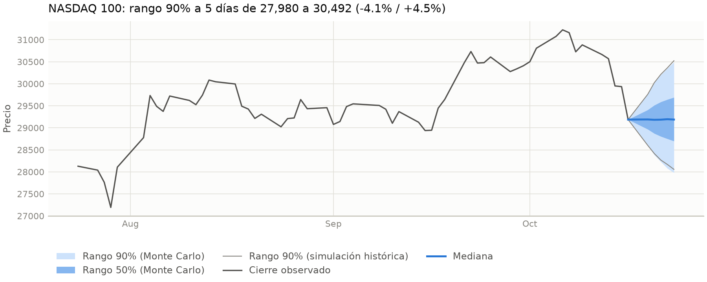
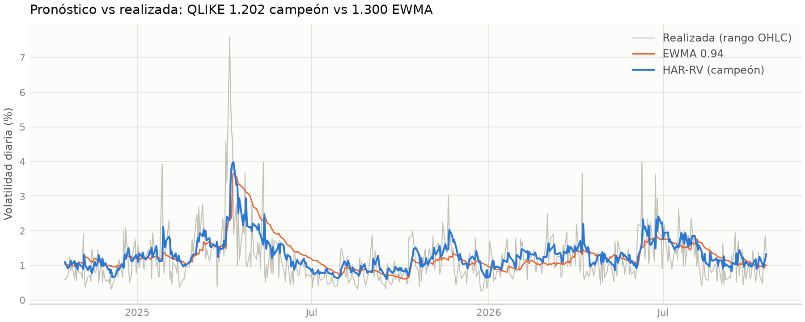
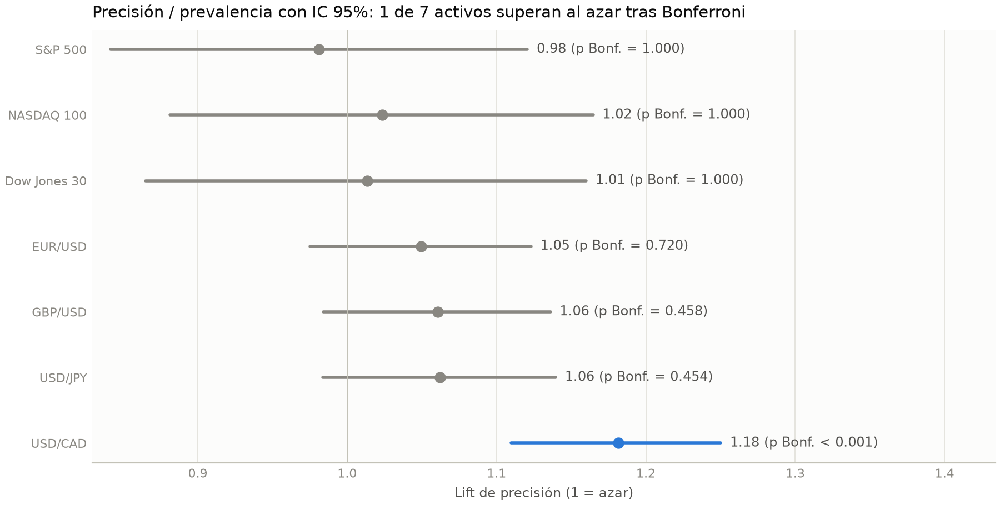

# Señales automatizadas de anomalías y volatilidad

Sistema que vigila 7 activos (S&P 500, NASDAQ 100, Dow Jones 30, EUR/USD,
GBP/USD, USD/JPY, USD/CAD) sin intervención humana: detecta movimientos de
precio estadísticamente inusuales, pronostica la volatilidad del día
siguiente, **registra cada predicción, la compara después contra lo que
realmente pasó, mide su propio acierto frente a un baseline ingenuo y se
reentrena solo** cuando su desempeño lo justifica.

> No es una estrategia de trading ni una recomendación de inversión: es un
> indicador estadístico de condiciones de mercado.

## Qué hace, en una frase por señal

| Señal | Datos | Pregunta que responde | Se compara contra |
|---|---|---|---|
| Anomalía | Velas de 5 min (ya cerradas) | ¿El último movimiento es inusual y suele revertirse? | Marcar anomalías al azar con la misma frecuencia |
| Volatilidad (GARCH, GJR, EGARCH o HAR-RV, el campeón por activo) | Velas diarias OHLC desde 2010 | ¿Cuánto se moverá el activo mañana y en qué rango puede estar en 5 días? | EWMA RiskMetrics (λ = 0.94) y desviación estándar de 20 días |
| VaR / CVaR 95% y 99% | Residuos estandarizados del campeón | ¿Qué pérdida diaria solo se supera el 1% / 5% de los días? | Cobertura nominal (Kupiec) e independencia de excepciones (Christoffersen) |

## Arquitectura

```
run_pipeline.py                    punto de entrada único (solo orquesta)
  └─ por cada señal y cada activo:
     1. src/data            ingesta OHLC yfinance (reintentos) + contratos
                            Pandera, reparación explícita de velas y alerta
                            de cotizaciones rancias
     2. src/features        retornos log causales; varianza por rango
                            (Parkinson, Garman-Klass, Rogers-Satchell,
                            Yang-Zhang); estacionalidad intradía por hora UTC
     3. src/models          detector / familia de volatilidad campeona
                            + escenarios Monte Carlo y simulación histórica
                            filtrada  ->  src/persistence (predictions)
     4. src/pipeline/evaluate_and_retrain.py
          resultado real -> pérdida modelo y baseline (outcomes)
          métrica agregada F1 / QLIKE vs baseline      (evaluation_runs)
          src/evaluation/feedback_loop.py  -> ¿reentrenar?
          src/pipeline/retrain.py  walk-forward (TimeSeriesSplit) -> promover
                                   solo si supera al baseline (model_registry)

run_pipeline.py --mode report      (no escribe en la base)
  src/evaluation/volatility_selection.py  champion-challenger por activo
  src/evaluation/var_backtest.py          Kupiec + Christoffersen
  src/reporting/                          HTML autocontenido + PDF + PNG
```

Todo el historial vive en `data/pipeline.db` (SQLite), que GitHub Actions
actualiza y versiona en cada corrida: cualquier decisión del sistema se
puede auditar consultando qué modelo predijo qué, qué pasó después y por
qué se reentrenó (o no).

### Disparador de reentrenamiento

1. **Enfriamiento de 24 h** entre intentos (evita bucles si un candidato no
   se promueve).
2. **Cadencia fija**: 30 días (anomalías) / 7 días (GARCH).
3. **Degradación sostenida**: 3 corridas seguidas con el modelo activo peor
   que su baseline (F1 sobre los últimos 500 resultados / QLIKE sobre los
   últimos 60), con muestra mínima exigida.
4. **Drift**: ADWIN sobre la pérdida punto a punto del modelo activo.

Un candidato solo reemplaza al modelo activo si supera al baseline en una
validación walk-forward (`TimeSeriesSplit`, nunca split aleatorio; con
`gap` igual al horizonte de la etiqueta en anomalías).

### Selección de la familia de volatilidad (champion-challenger)

Por activo compiten GARCH(1,1)-t, GJR-GARCH-t, EGARCH-t y HAR-RV en el
mismo walk-forward de 4 bloques. Los parámetros se estiman solo con el
bloque de entrenamiento y la varianza se filtra con recursiones explícitas
iniciadas en la varianza de entrenamiento (sin fuga del backcast de
muestra completa). Reglas:

- La pérdida es QLIKE contra r², robusta a proxies ruidosos (Patton 2011).
  Los estimadores por rango subestiman con muestreo discreto, así que solo
  alimentan a HAR re-escalados en entrenamiento; nunca deciden el campeón.
- Una familia que no converge o no es estacionaria en algún bloque queda
  excluida y se reporta; todas las comparaciones usan la muestra común.
- El campeón vigente solo cambia si un retador le gana con Diebold-Mariano
  (HAC, corrección Harvey-Leybourne-Newbold) y p ajustado por Holm < 0.05,
  y además supera a la desviación móvil de 20 días.
- El VaR publicado es el mismo que se valida: cuantil empírico de los
  residuos estandarizados de entrenamiento × σ pronosticada.

## Cómo ejecutarlo

Requisitos: Python 3.11+ (probado localmente en 3.14; CI usa 3.12). No hace falta ninguna
API key: `yfinance` es pública.

```bash
python -m venv .venv
.venv\Scripts\activate                 # Windows (macOS/Linux: source .venv/bin/activate)
pip install -r requirements-dev.lock   # versiones fijadas (las de CI)
pytest -q                              # 156 pruebas, sin red
python run_pipeline.py                 # ciclo completo, todos los activos
python run_pipeline.py --mode report   # reporte HTML + PDF + PNG -> reports/
```

| Comando | Qué hace | Escribe en la base |
|---|---|---|
| `python run_pipeline.py` | Predice, evalúa y decide reentrenar (ambas señales) | Sí |
| `python run_pipeline.py --signals anomaly` | Solo anomalías (lo que corre cada 15 min) | Sí |
| `python run_pipeline.py --signals garch` | Solo GARCH (lo que corre al cierre) | Sí |
| `python run_pipeline.py --mode report` | Walk-forward histórico de ambas señales y reporte en `reports/report_<UTC>/` (`report.html` autocontenido, `report.pdf` ejecutivo A4 y `figures/*.png` a 200 dpi). Tarda ~40 s en CPU; `--mode backtest` es un alias | No |

Código de salida: `0` si todo terminó bien, `1` si algún activo o etapa
falló (el fallo se registra y, si configuras
`PIPELINE_ALERT_WEBHOOK_URL`, se notifica; ver `.env.example`).

## Resultados (reporte walk-forward del 2026-10-17)

Validación fuera de muestra de 2013-05 a 2026-10 (~3,400 días por activo).
QLIKE: menor es mejor. DM t < 0: el campeón tuvo menor pérdida que EWMA.

| Activo | Campeón | QLIKE campeón | QLIKE EWMA | DM t (p) vs EWMA | VaR 99% Kupiec p | Christoffersen p |
|---|---|---|---|---|---|---|
| S&P 500 | HAR-RV | 0.645 | 0.752 | −4.36 (< 0.001) | 0.507 | 0.271 |
| NASDAQ 100 | HAR-RV | 1.202 | 1.300 | −6.18 (< 0.001) | 0.376 | **0.010** |
| Dow Jones 30 | HAR-RV | 0.570 | 0.663 | −4.50 (< 0.001) | 0.895 | **0.004** |
| EUR/USD | GARCH(1,1)-t | −0.570 | −0.560 | −0.92 (0.179) | 0.870 | 0.342 |
| GBP/USD | GARCH(1,1)-t | −0.316 | −0.313 | −0.19 (0.424) | 0.402 | 0.336 |
| USD/JPY | GARCH(1,1)-t | −0.277 | −0.263 | −1.30 (0.097) | 0.726 | 0.063 |
| USD/CAD | HAR-RV | −0.773 | −0.736 | −3.24 (< 0.001) | **0.002** | 0.887 |

Lectura honesta:

- **Índices**: HAR-RV le gana con significancia al GARCH vigente y a EWMA.
  Es el resultado más sólido del proyecto.
- **FX**: en EUR/USD, GBP/USD y USD/JPY ningún modelo supera a EWMA con
  significancia; el GARCH se conserva porque ningún retador lo desplaza,
  no porque sea claramente mejor. En USD/CAD HAR-RV sí gana.
- **GJR y EGARCH no ganaron en ningún activo**; además GJR quedó excluido
  en GBP/USD (no estacionario en un bloque) y EGARCH en USD/JPY (no
  convergió).
- **VaR 99%**: cobertura correcta en 6 de 7 activos. En USD/CAD hay 55
  excepciones en 3,492 días (1.58% vs 1% nominal): el VaR es demasiado
  estrecho. En NASDAQ 100 y Dow Jones las excepciones se agrupan en crisis.
- **Detector de anomalías**: solo USD/CAD tiene precisión significativamente
  mayor a la prevalencia tras Bonferroni (lift 1.18); el AUC está entre
  0.499 y 0.536. Sigue siendo un filtro de atención, no un predictor.
- **Hallazgo de datos**: en FX, Yahoo fecha el cierre diario al inicio del
  día (open ≈ close) mientras el alto-bajo cubre el día. Sin re-alinearlo,
  el rango del día filtraba el retorno a pronosticar y HAR parecía ganar en
  todos los pares; corregido, esa ventaja desapareció salvo en USD/CAD.







Backtest anterior (2026-09-24, solo GARCH):
`reports/backtest_20260924T155019Z/backtest.md`.

### Auditoría del 2026-10-17

Una auditoría independiente
([`docs/auditoria_2026-10-17.md`](docs/auditoria_2026-10-17.md)) matizó
estos resultados y corrigió cinco defectos de medición:

- Contra un baseline ingenuo más exigente (EWMA RiskMetrics, λ = 0.94), el
  GARCH es significativamente mejor solo en los 3 índices (Diebold-Mariano
  p ≤ 0.001); en los 4 pares FX la ventaja no es significativa.
- La etiqueta de reversión contaba los empates (retorno 0) como reversión;
  en EUR/USD el 34% de las velas de 5 min tienen retorno 0, lo que hacía
  parecer al detector peor que el azar. Corregido, solo USD/CAD tiene una
  precisión significativamente mayor a la prevalencia tras Bonferroni.
- Los candidatos ahora se promueven solo con significancia estadística:
  test binomial de precisión vs prevalencia (anomalías) y Diebold-Mariano
  vs baseline (GARCH), con `promotion_alpha = 0.05`.
- La ingesta diaria descarta la vela del día en curso, que Yahoo publica
  con el último precio y que contaminaba el 67% de los resultados GARCH-FX.
- Cada corrida registra todas las velas cerradas fuera de muestra desde el
  entrenamiento del detector (no solo la última), porque GitHub Actions
  ejecutó solo ~9% de los cron de 15 min programados.

## Automatización

- `.github/workflows/pipeline.yml`: corre `run_pipeline.py` cada 15 min en
  horario de mercado (anomalías) y a las 00:30 UTC de mar a sáb (GARCH,
  cuando ya cerraron las velas diarias de índices y FX), y versiona
  `data/pipeline.db`. GitHub envía un correo si el job falla.
- `.github/workflows/report.yml`: cada lunes a las 01:00 UTC (y a mano con
  `workflow_dispatch`) genera el reporte y lo publica como artefacto de la
  corrida.
- `.github/workflows/ci.yml`: en cada push, Ruff (PEP8 a 79 columnas, type
  hints, docstrings, sin `except` genérico) y pytest.

## Consultar el historial

```sql
-- Últimas métricas del modelo activo vs baseline, por activo
SELECT asset_symbol, signal_type, evaluated_at, n_outcomes,
       metric_name, model_metric, baseline_metric
FROM evaluation_runs
ORDER BY evaluated_at DESC
LIMIT 20;

-- Historial de modelos y por qué se promovieron o no
SELECT asset_symbol, signal_type, version, stage, created_at,
       validation_metrics_json
FROM model_registry
ORDER BY created_at DESC;
```

## Limitaciones conocidas

- Los estimadores de varianza por rango subestiman con muestreo discreto;
  por eso no deciden el campeón.
- En FX la ventana alto-bajo de Yahoo no cubre las 24 h (~25% de las velas
  se ensanchan al re-alinear el cierre) y el último día FX disponible va un
  día detrás de los índices.
- El test de lift del detector trata las velas como independientes; las
  etiquetas se solapan y las anomalías se agrupan, así que su p-valor es
  optimista.

- Yahoo Finance (vía `yfinance`) es una fuente no oficial y gratuita: puede
  limitar peticiones o cambiar su formato. El sistema falla de forma
  explícita en ese caso, pero no lo evita.
- Las velas de 5 minutos solo están disponibles para los últimos 60 días,
  así que la validación del detector usa esa ventana.
- GitHub Actions no garantiza los cron frecuentes: entre el 2026-09-24 y
  el 2026-10-17 corrió 54 de ~630 ciclos programados. El backfill de
  velas cerradas evita perder muestra si hay al menos una corrida cada 5
  días (`predict_period`); un scheduler externo daría puntualidad real.
- El horario del cron sigue el mercado de EE. UU.; en forex (24/5) las
  velas fuera de ese horario se registran por backfill en la corrida
  siguiente.
- SQLite versionado en el repo alcanza para un solo escritor secuencial;
  con escritores concurrentes habría que migrar `src/persistence/database.py`
  a Postgres.

## Problemas comunes al ejecutarlo en Windows

| Síntoma | Causa | Solución |
|---|---|---|
| `WinError 206` o error al cargar una DLL (Pillow, matplotlib, scikit-learn) | La ruta de la carpeta supera el límite de 260 caracteres de Windows | Mueve el proyecto a una ruta corta, por ejemplo `C:\dev\trading_signals` |
| `curl: (60) SSL certificate ... unable to get local issuer certificate`, o `yfinance` devuelve datos vacíos | Un antivirus con escaneo HTTPS (por ejemplo Avast Web Shield) firma los certificados con su propia raíz | Agrega `yahoo.com` como excepción del escaneo HTTPS del antivirus |

Ninguno de los dos afecta la ejecución en GitHub Actions (Linux, sin
antivirus ni límite de ruta).

## Notebook de exploración

`notebooks/01_eda_original.ipynb` es el EDA con el que empezó el proyecto
(GARCH sobre SPY con pruebas ADF, Ljung-Box y ARCH-LM, y el menú
interactivo original). Se conserva como referencia; no forma parte de
producción y no se valida con Ruff.

## Estructura

```
run_pipeline.py              punto de entrada único
src/                         código de producción (config, data, features,
                             models, persistence, evaluation, pipeline,
                             reporting, notifications)
tests/                       156 pruebas pytest (contratos OHLC, fuga,
                             estimadores, modelos, selección, VaR,
                             reporte, integración, entry point)
data/pipeline.db             historial auditable (lo crea el pipeline)
notebooks/                   EDA original (referencia)
reports/                     reportes generados (solo se versionan los
                             citados aquí)
docs/                        auditoría e imágenes del README
.github/workflows/           pipeline programado + CI
.vscode/                     configuración de ejecución y depuración
```
